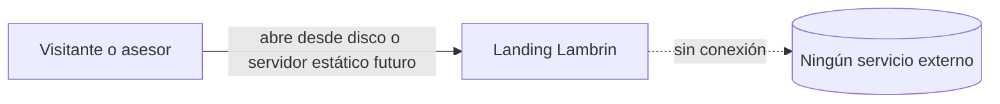
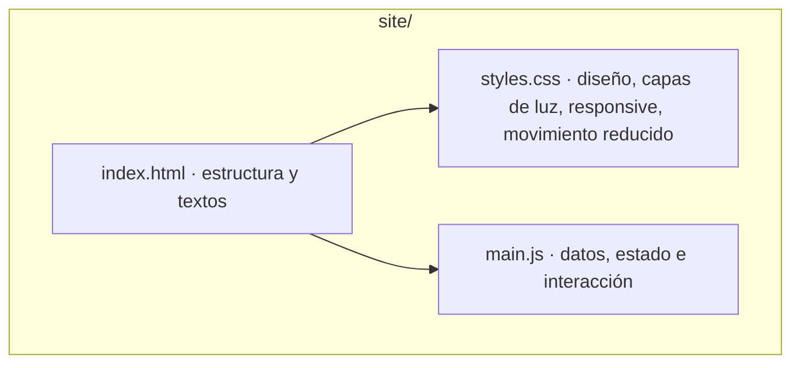
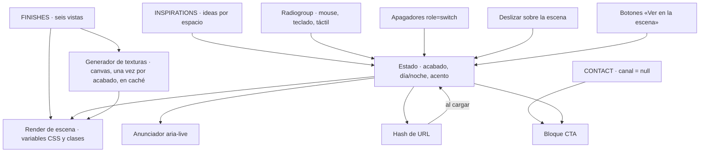
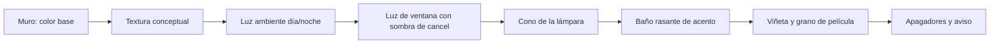

# 02 — Diagramas
Estado: Vigente — aprobado en PG2, construido en F4 (PG4, 2026-10-28)

## C4 · Contexto

## C4 · Contenedores
Un solo contenedor: archivos estáticos en `site/`. No hay servidor, base de datos ni terceros.

## C4 · Componentes de `main.js`

## Capas de la escena (de atrás hacia adelante)

La geometría (posición del muro, la ventana, la lámpara y los apagadores) es fija para todos los acabados; solo cambian color, textura y respuesta a la luz.
