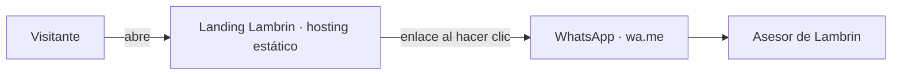
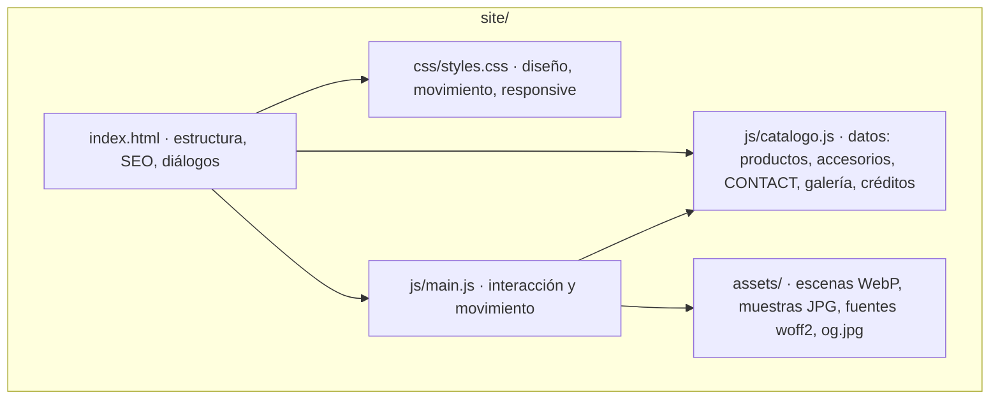
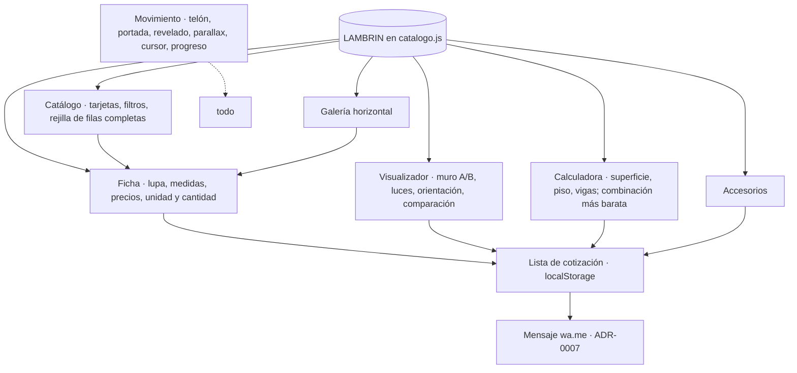

# 02 — Diagramas (v2)
Estado: Vigente (v2) — PG0–PG3 2026-10-28, PG4 2026-10-29; PG5 2026-10-29

## C4 · Contexto

## C4 · Contenedores

## Componentes de `main.js`

## Flujo del visitante
Portada → Catálogo (filtro) → Ficha (color, lupa, precio) → Visualizador o Calculadora → Lista de cotización → WhatsApp.
