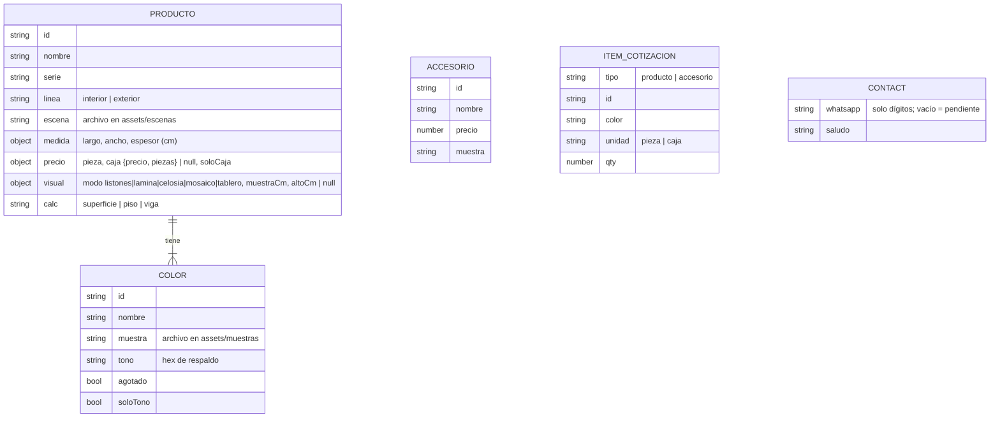

# 03 — Modelo de datos (v2)
Estado: Vigente (v2) — PG0–PG3 2026-10-28, PG4 2026-10-29; PG5 2026-10-29

Sin base de datos ni datos personales. La configuración vive en `site/js/catalogo.js` (ADR-0006); la lista de cotización se guarda solo en el `localStorage` del visitante con la clave `lambrin-cotizacion`.

## Reglas
- Precios en MXN tal como el catálogo; leyenda `LEYENDA_PRECIOS`. No se menciona IVA.
- Calculadora: piezas = ⌈área × (1 + merma) / (largo × ancho)⌉; vigas = ⌈(ancho + separación) / (ancho viga + separación)⌉ × tramos × (1 + merma). Merma por defecto 10 % (5 o 15 % opcional). Combinación: mínimo costo entre k cajas + piezas sueltas; con `soloCaja`, solo cajas.
- Visualizador: muro de referencia de 300 cm de ancho; el ancho de cada mosaico en pantalla es proporcional a `muestraCm`.
