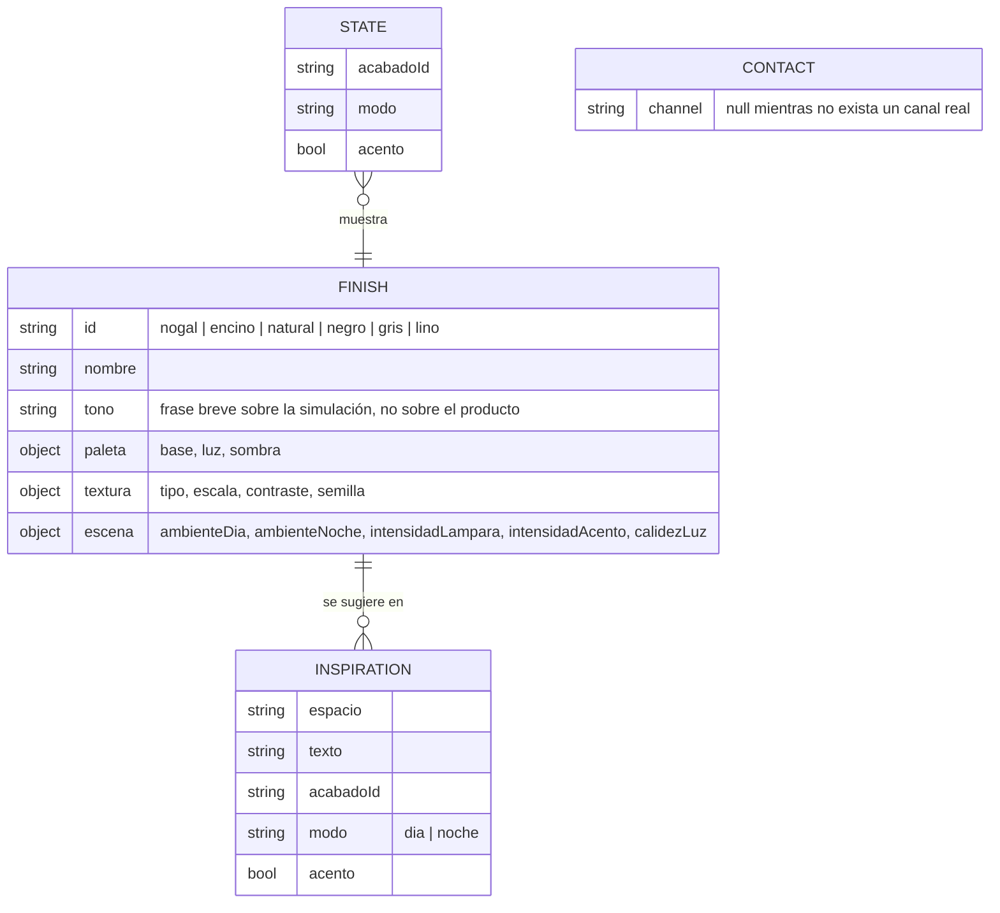

# 03 — Modelo de datos
Estado: Vigente — aprobado en PG2, construido en F4 (PG4, 2026-10-28)

No hay base de datos, persistencia ni datos personales. Todo es configuración estática en `main.js` y estado en memoria. Dueño de los datos: el proyecto Lambrin; los valores visuales son **conceptuales** y no provienen de un catálogo.

## Reglas
- `textura.tipo` toma uno de tres patrones conceptuales: `veta` (Nogal, Encino, Natural), `mineral` (Negro, Gris) y `tejido` (Lino). Es una interpretación visual del nombre, no una afirmación de material.
- Sin juntas ni modulación visibles: el formato de pieza no está verificado.
- `escena` ajusta cuánto se ilumina cada acabado para que los oscuros (Nogal, Negro) se lean igual de bien que los claros. No cambia la geometría.
- `CONTACT.channel` solo puede recibir un canal confirmado por el usuario; cambiarlo requiere aprobación (es una integración).
- El estado inicial es Nogal, día, sin acento, salvo que el hash indique otro acabado.
